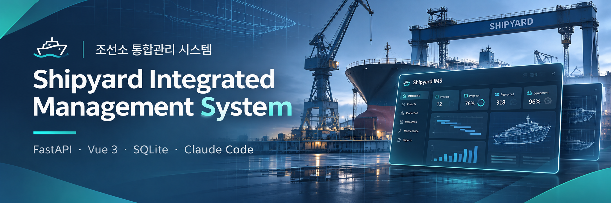
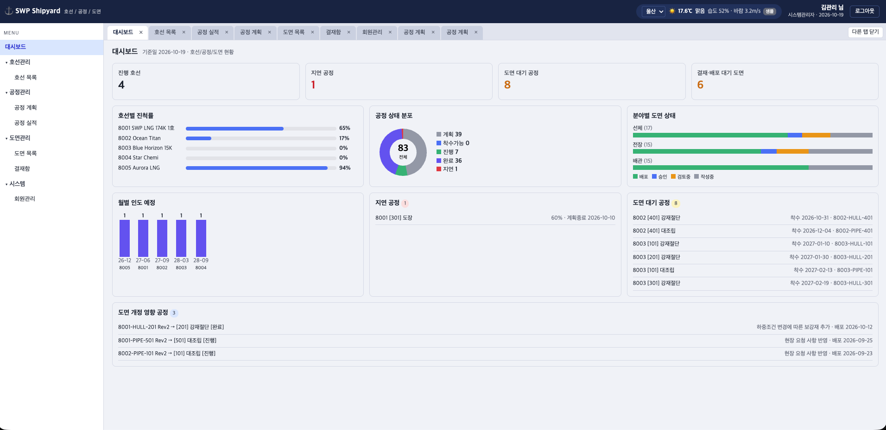
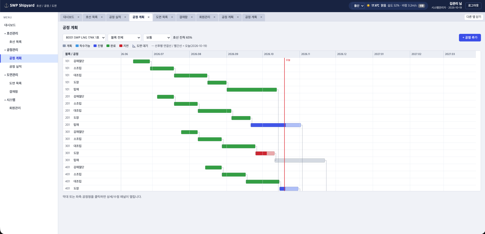
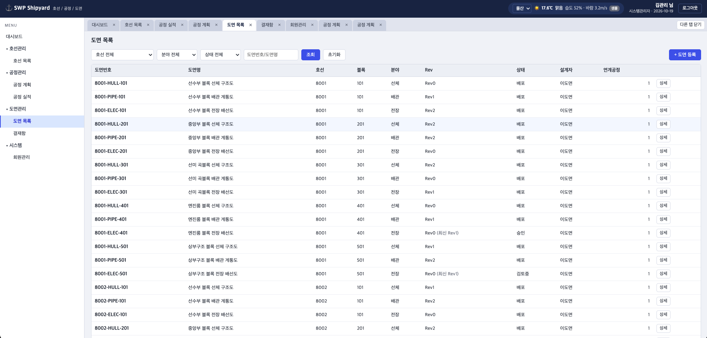
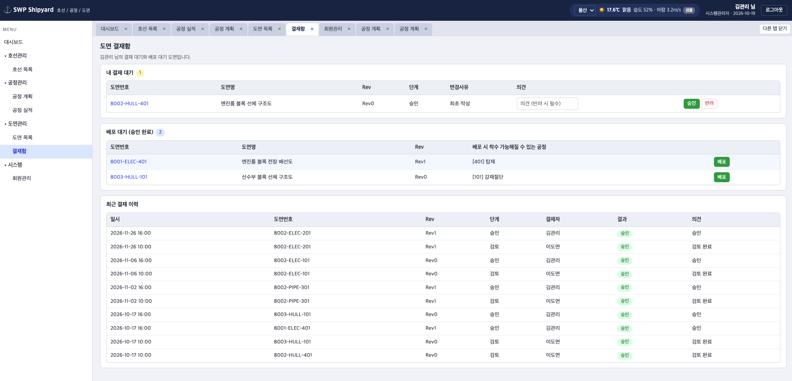
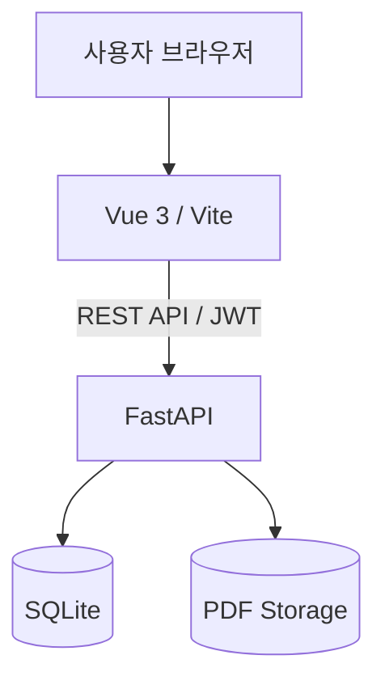
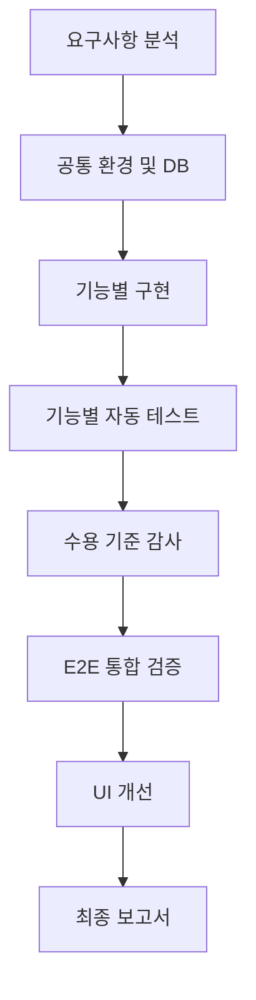

<div align="center">

<!-- 대표 이미지를 docs/images/cover.png에 추가 -->


# ⚓ Shipyard Integrated Management System

### Claude Code 기반 조선소 통합관리 시스템

**HTML Mockup → FastAPI + Vue 3 + SQLite**

요구사항 중심 개발 · 토큰 최적화 · Skill & MCP · 자동화 테스트


</div>
 
--

## 📌 프로젝트 소개

기존 **조선소 통합관리 시스템 HTML 목업**을 실제 데이터 저장과 사용자 인증, 업무 프로세스를 지원하는 **3-Tier 웹 애플리케이션**으로 구현한 프로젝트입니다.

단순히 Claude Code를 이용하여 코드를 생성하는 데 그치지 않고, **토큰 사용량을 관리하면서 개발 품질과 작업 효율을 높이는 워크플로**를 설계했습니다.

> **핵심 목표**
>
> 동일한 요구사항을 충족하는 과정에서 불필요한 컨텍스트 입력, 반복적인 파일 탐색, 중복 테스트, 재작업을 최소화하는 것.

### 🎯 프로젝트 핵심 지표

| 항목 | 결과 |
|:---|:---|
| 기능 영역 | F01 ~ F09 (9개) |
| 수용 기준 감사 | **68 / 68 PASS** |
| 백엔드 테스트 | **106건 통과** |
| 프론트엔드 테스트 | **46건 통과** |
| 브라우저 검증 | Playwright MCP 활용 |
| UI 개선 | 공통 스타일 정비 및 화면별 보완 |

> 테스트 수치는 마지막으로 확인된 기록 기준이며, 최종 제출 시 최신 결과로 갱신합니다. 수용 기준 PASS와 전체 E2E 검증 완료는 구분합니다.

┌───────────┬────────────┐
│   항목    │    토큰    │
├───────────┼────────────┤
│ 입력      │ 920        │
├───────────┼────────────┤
│ 출력      │ 578,069    │
├───────────┼────────────┤
│ 캐시 생성 │ 1,384,791  │
├───────────┼────────────┤
│ 캐시 읽기 │ 62,931,340 │
└───────────┴────────────┘

---

## 📸 주요 화면

<!-- 캡처한 이미지를 아래 경로에 저장 -->

### 01. 통합 대시보드



호선별 현황, 주요 KPI, 도면 결재 현황, 공정 정보를 통합적으로 조회합니다.

### 02. 공정 계획 및 간트



호선별 공정 계획, 선행 공정, 진척률 및 도면 연계 상태를 관리합니다.

### 03. 도면 관리



도면 기본 정보, 리비전 이력, PDF 및 연계 공정을 관리합니다.

### 04. 결재 및 사용자 관리



도면 결재 요청, 승인·반려, 배포 및 사용자 권한 관리 기능을 제공합니다.

---

## 🛠 Tech Stack

| Category | Technology |
|:---|:---|
| Frontend | Vue 3, Vite, JavaScript |
| Backend | Python, FastAPI |
| Database | SQLite |
| Authentication | JWT, OTP, RBAC |
| Frontend Testing | Vitest |
| Backend Testing | pytest |
| E2E Testing | Playwright MCP |
| AI Development | Claude Code CLI |
| AI Tools | Skill, MCP |
| Documentation | Markdown, CLAUDE.md |

---

## 🏗 System Architecture



### 3-Tier Architecture

**Presentation Layer**

- Vue 3 기반 SPA
- 공통 메뉴, 탭, 모달 및 화면 이동
- 데이터 입력 및 시각화

**Application Layer**

- FastAPI 기반 REST API
- 인증 및 권한 검증
- 도면, 공정, 결재 등 비즈니스 로직

**Data Layer**

- SQLite 데이터베이스
- 호선, 공정, 도면, 결재 및 사용자 정보
- PDF 파일 저장소

---

## 🧩 주요 기능

| 기능 | 설명 |
|:---|:---|
| **F01 인증** | 로그인, 회원가입, JWT, OTP, RBAC |
| **F02 공통 UI** | 헤더, 사이드바, 탭, 화면 이동 |
| **F03 대시보드** | 주요 KPI 및 업무 현황 |
| **F04 호선 관리** | 호선, 블록, 마일스톤 |
| **F05 공정계획** | 간트, 선행 공정, 도면 연계 |
| **F06 공정 실적** | 작업 실적, 진척률, 상태 갱신 |
| **F07 도면 관리** | 도면, 리비전, PDF 관리 |
| **F08 결재 관리** | 결재 요청, 승인, 반려, 배포 |
| **F09 사용자 관리** | 사용자 승인, 권한 그룹 관리 |

---

# ⚡ Claude Code 토큰 최적화 전략

본 프로젝트의 핵심은 단순히 프롬프트를 짧게 만드는 것이 아닙니다.

**작업 범위와 컨텍스트를 구조적으로 관리하여 불필요한 토큰 사용과 재작업을 줄이는 것**을 목표로 했습니다.

## 01. Context Engineering

### CLAUDE.md / Rules / Skill 분리

매번 동일한 지시를 프롬프트에 입력하지 않고 역할에 따라 분리했습니다.

```text
shipyard-claude/
│
├── CLAUDE.md
│
├── .claude/
│   ├── rules/
│   │   └── file-reading.md
│   │
│   └── skills/
│       └── implement-feature/
│           └── SKILL.md
│
├── docs/
│   ├── features/
│   │   ├── F01.md
│   │   ├── F02.md
│   │   └── ...
│   │
│   └── handoffs/
│       ├── status.md
│       ├── decisions.md
│       └── tool-evidence.md
│
└── reference/
    └── shipyard_mockup.html
```

### 역할 분리

| 파일 | 역할 |
|:---|:---|
| CLAUDE.md | 프로젝트 공통 규칙 및 개발 원칙 |
| Rules | 파일 탐색 범위 및 작업 제약 |
| Skill | 반복적인 기능 구현 절차 |
| Feature Specs | 기능별 요구사항 및 수용 기준 |
| Handoffs | 작업 상태 및 결정 사항 |

### 기대 효과

- 반복 프롬프트 작성 감소
- 필요한 문서만 선택적으로 참조
- 작업 간 일관성 유지
- 세션 변경 시 컨텍스트 재구성 부담 완화

공통 설정 파일도 토큰을 사용하므로 불필요한 설명은 최소화했습니다.

---

## 02. 영어 중심의 간결한 프롬프트

Claude Code 작업 지시는 주로 영어로 작성하고 최종 결과는 한국어로 받도록 구성했습니다.

### Prompt Structure

```text
Goal
  수행할 작업

Scope
  확인하거나 수정할 범위

Constraints
  변경하지 말아야 할 영역

Validation
  완료 후 검증 항목

Stop
  작업 종료 조건
```

### 실제 적용 패턴

```text
Fix the shared layout issue.

- Inspect only affected frontend files.
- Preserve existing functionality.
- Avoid unrelated refactoring.
- Run focused tests and build.
- Stop after the fix.

Report briefly in Korean.
```

### 최적화 포인트

장황한 설명 대신 명확한 작업 범위와 종료 조건을 전달하여 불필요한 코드 탐색과 수정 확장을 방지했습니다.

> 영어가 한국어보다 항상 토큰을 적게 사용하는 것은 아닙니다. 실제 효율은 문장 길이와 토크나이저에 따라 달라지며, 핵심은 중복 지시를 제거하는 것입니다.

---

## 03. 기능별 작업 분리

전체 시스템을 한 번에 구현하도록 요청하지 않고 기능을 F01~F09로 분리했습니다.



### 적용 원칙

- 기능별 요구사항을 독립된 문서로 관리
- 구현 대상 파일과 기능 범위를 제한
- 기능 구현 후 관련 테스트 실행
- 디자인 개선은 기능 검증 이후 수행
- 기존 구현을 불필요하게 재작성하지 않음

이러한 단계적 개발 방식을 통해 여러 기능이 동시에 변경되면서 발생할 수 있는 재작업을 줄이고자 했습니다.

---

## 04. Skill 기반 개발 자동화

반복적인 기능 구현 절차를 프로젝트 전용 Skill로 구성했습니다.

### implement-feature

```text
.claude/skills/implement-feature/SKILL.md
```

실행 예시:

```text
/implement-feature F04
```

### 활용 목적

- 구현 절차 표준화
- 기능 명세 기반 개발
- 테스트 및 결과 기록 흐름 재사용
- 반복적인 프롬프트 작성 최소화

Skill은 모든 작업에 무조건 호출하지 않고, 반복되는 기능 구현 작업에 선택적으로 적용했습니다.

실제 호출 여부는 실행 기록을 기준으로 관리했습니다.

---

## 05. MCP 활용

MCP(Model Context Protocol)를 활용하여 Claude Code의 외부 도구 사용 범위를 확장했습니다.

| MCP | 활용 목적 |
|:---|:---|
| Playwright MCP | 브라우저 기반 UI 및 통합 테스트 |
| Context7 MCP | 라이브러리 공식 문서 조회 |
| SQLite MCP | 데이터베이스 구조 및 데이터 확인 |

### Playwright MCP

로그인, 화면 이동, 도면 결재, 권한 변경 등 실제 브라우저에서 여러 기능이 연결되는 흐름을 검증하는 데 활용했습니다.

### MCP 호출 최적화

- 단위 테스트로 확인된 동작은 반복 검증하지 않음
- 관련 업무 흐름을 하나의 시나리오로 구성
- 불필요한 DOM 전체 출력 방지
- 반복 스크린샷 최소화
- 필요한 데이터와 화면만 조회

> MCP를 설정한 것과 실제 호출한 것은 구분했습니다. Context7 및 SQLite MCP의 실제 활용 실적은 실행 로그로 확인된 경우에만 성과로 반영합니다.

---

## 06. Session Management

Claude Code의 장기 세션에서는 대화와 도구 출력이 누적되므로 세션을 목적에 맞게 관리했습니다.

### 세션 유지가 유리한 경우

- 동일 기능의 구현과 수정
- 이전 분석 결과 재사용
- 관련 테스트를 연속 수행
- 공통 컨텍스트가 큰 작업

### 세션 전환을 고려한 경우

- 새로운 개발 단계 진입
- 기존 컨텍스트의 활용 가치 감소
- 기능 구현에서 UI 개선으로 전환
- 도구 오류가 반복되는 경우

### Handoff Strategy

```text
docs/handoffs/
├── status.md
├── decisions.md
├── tool-evidence.md
└── logs/
```

새 세션에서는 전체 대화 내용을 다시 설명하지 않고 인수인계 문서를 활용하도록 구성했습니다.

**세션을 자주 초기화한다고 반드시 토큰이 절약되는 것은 아닙니다.**

기존 캐시의 재사용 가능성과 새 세션의 초기 컨텍스트 비용을 함께 고려해야 합니다.

---

## 07. Multi-Terminal Workflow

개발 서버와 Claude Code를 분리하여 운영하는 방식을 사용했습니다.

```text
┌─────────────────────────────┐
│ Terminal 1                  │
│ Claude Code CLI             │
│ 기능 구현 및 검증 지시       │
└─────────────────────────────┘

┌─────────────────────────────┐
│ Terminal 2                  │
│ FastAPI Backend             │
│ API 서버 및 로그             │
└─────────────────────────────┘

┌─────────────────────────────┐
│ Terminal 3                  │
│ Vue / Vite Frontend         │
│ UI 서버 및 HMR              │
└─────────────────────────────┘
```

### 장점

- 서버 재실행 작업 감소
- 백엔드와 프론트엔드 로그 분리
- Claude Code 작업과 개발 서버 독립 운영
- 반복적인 환경 설정 시간 감소

멀티 터미널 자체가 토큰을 절감하는 기술은 아니지만 반복 작업과 도구 실행의 비효율을 줄이는 데 도움이 됩니다.

동일 파일을 여러 Claude Code 세션에서 동시에 수정하는 방식은 충돌 위험을 고려해 구분했습니다.

---

## 08. Prompt Caching

Claude Code 사용량은 일반 입력 토큰뿐 아니라 캐시 생성 및 캐시 읽기 토큰도 함께 고려해야 합니다.

| 지표 | 설명 |
|:---|:---|
| input_tokens | 일반 입력 |
| output_tokens | 출력 |
| cache_creation_input_tokens | 캐시 생성 |
| cache_read_input_tokens | 캐시 재사용 |

### 캐싱을 고려한 운영 전략

- 공통 프로젝트 지침 유지
- 동일 업무의 연속 작업에서 컨텍스트 재사용
- 파일 전체를 반복해서 읽는 작업 제한
- 세션 전환 시점 관리
- 캐시 사용량과 신규 입력량 분리 분석

캐시 읽기 토큰은 일반 입력 토큰과 과금 방식이 다를 수 있으므로, 단순 총합만으로 비용 절감 효과를 판단하지 않았습니다.

---

## 09. Selective File Reading

원본 HTML 목업의 전체 코드를 반복해서 읽는 대신 관련 구간만 조회하도록 구성했습니다.

### 적용 방식

```text
기능 명세 확인
       ↓
관련 HTML 위치 확인
       ↓
필요한 CSS/JS 구간 탐색
       ↓
관련 Vue 컴포넌트 수정
       ↓
변경 영역 테스트
```

### UI 최적화 사례

공통 UI 개선 단계에서는 로그인 카드에 적용한 너비 스타일이 결재함과 회원관리 카드에도 영향을 주는 문제가 있었습니다.

화면별로 CSS를 덧붙이는 대신 공통 클래스 충돌의 원인을 수정했습니다.

또한 Grid, 버튼, 배지 등 공통 클래스의 누락과 잘못된 정렬 규칙을 해결하여 여러 화면을 함께 개선했습니다.

---

## 10. Test Optimization

테스트 도구마다 검증 범위를 분리했습니다.

| 테스트 도구 | 검증 대상 |
|:---|:---|
| pytest | API, 데이터, 업무 로직, 권한 |
| Vitest | Vue 컴포넌트, 이벤트, 상태 전달 |
| Playwright MCP | 화면 이동, 실제 사용자 업무 흐름 |

### 핵심 전략

- 모든 기능을 브라우저에서 반복 테스트하지 않음
- 기존 테스트에서 확인된 로직 재검증 최소화
- 화면 간 연계는 E2E로 확인
- 변경된 기능 중심으로 테스트 실행
- 결과를 PASS / FAIL / UNVERIFIED로 구분

### 수용 기준 감사 결과

| 단계 | PASS | FAIL | UNVERIFIED |
|:---|---:|---:|---:|
| 최초 감사 | 66 | 1 | 1 |
| 수정 및 재검증 | **68** | **0** | **0** |

기능 감사와 E2E 검증 결과는 별도로 관리했습니다.

---

## 11. Token Usage Analysis

Claude Code의 토큰 사용량은 `extract_usage.py`를 이용하여 기록했습니다.

### 수집 지표

- 일반 입력 토큰
- 출력 토큰
- 캐시 생성 토큰
- 캐시 읽기 토큰
- API 호출 횟수
- 세션 및 단계별 사용량

### 분석 방식

```text
단계별 사용량 증가분
= 현재 시점의 누적 사용량
- 이전 시점의 누적 사용량
```

### 초기 단계 사용량 기록

| 단계 종료 | 누적 토큰 합계* | 이전 대비 증가량* |
|:---|---:|---:|
| P0 | 1,816,913 | - |
| P1 | 5,352,166 | 3,535,253 |
| P2 | 9,900,564 | 4,548,398 |
| P3 | 17,102,048 | 7,201,484 |

*입력, 출력, 캐시 생성, 캐시 읽기를 단순 합산한 값입니다.*

이는 실제 과금 비용이나 순수 신규 입력 토큰이 아닙니다. 여러 세션의 누적 기록이 포함될 수 있으므로 개별 단계의 정확한 비용과는 구분해야 합니다.

### 분석 시 주의사항

- 누적 스냅샷을 다시 합산하지 않음
- 세션 ID를 기준으로 중복 집계 여부 확인
- 캐시 읽기 토큰과 일반 입력 토큰 구분
- 토큰 총량과 실제 비용을 동일하게 취급하지 않음

---

## ✅ 품질 검증

### 자동 테스트

| 항목 | 마지막 확인 결과 |
|:---|:---|
| Backend pytest | 106 PASS |
| Frontend Vitest | 46 PASS |
| Frontend Build | SUCCESS |
| Acceptance Criteria | 68 / 68 PASS |

### E2E 검증

Playwright MCP를 통해 다음 주요 흐름을 확인했습니다.

- 로그인 및 사용자 권한
- 도면 결재 승인·반려
- 도면 배포 후 공정 상태 변경
- 대시보드 데이터 갱신
- 신규 사용자 승인 및 권한 변경

다만 일부 브라우저 테스트는 Claude API 500 오류로 중단되어 잔여 검증이 필요합니다.

---

## 🗂 Project Structure

```text
shipyard-claude/
│
├── backend/              # FastAPI 서버
├── frontend/             # Vue 3 웹 애플리케이션
├── database/             # SQLite / migrations
├── reference/            # 원본 HTML 목업
│
├── docs/
│   ├── features/         # 기능별 명세
│   ├── handoffs/         # 진행 기록 및 증빙
│   └── images/           # README 이미지
│
├── .claude/
│   ├── rules/
│   └── skills/
│
├── .mcp.json
├── CLAUDE.md
├── extract_usage.py
└── README.md
```

---

## 🚀 실행 가이드

> 아래는 실행 명령 예시입니다. 최종 제출 시 실제 프로젝트의 환경 설정 및 의존성 파일 기준으로 검증해야 합니다.

### Backend

```bash
cd backend

# 프로젝트 환경에 맞게 의존성 및 환경 변수 설정

uvicorn app.main:app --reload
```

### Frontend

```bash
cd frontend

npm install

npm run dev
```

---

## 💡 Lessons Learned

### 1. 토큰 최적화는 작업 범위 관리에서 시작된다

불필요한 전체 소스 탐색과 반복적인 작업 지시를 줄이는 것이 중요한 최적화 전략임을 확인했습니다.

### 2. Skill과 Rules는 목적에 따라 분리해야 한다

공통 원칙과 특정 작업 절차를 분리함으로써 개발 흐름의 일관성을 높일 수 있었습니다.

### 3. 테스트 자동화는 재작업 비용을 줄인다

기능별 테스트, 요구사항 감사, E2E 검증을 구분하여 구현 누락과 화면 연결 문제를 확인했습니다.

### 4. 세션 관리와 캐싱은 함께 고려해야 한다

세션 초기화 자체보다 컨텍스트 재구성 비용과 캐시 재사용 효과를 고려하는 것이 중요했습니다.

### 5. UI 개선은 공통 원인부터 수정해야 한다

공통 CSS를 먼저 정리하고 개별 화면을 보완하여 화면별 중복 수정을 줄였습니다.

---

## 📍 향후 보완

- 미완료 E2E 시나리오 검증
- 화면별 UI 세부 조정
- 최종 실행 환경 및 테스트 확인
- 완료보고서와 토큰 사용량 정리

---

<div align="center">

### ⚓ Built with Claude Code

**Context Engineering · Scoped Development · Skill & MCP · Token Optimization**

조선소 통합관리 시스템

</div>
