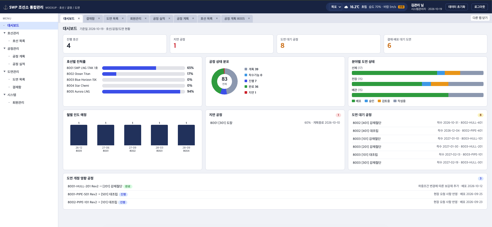
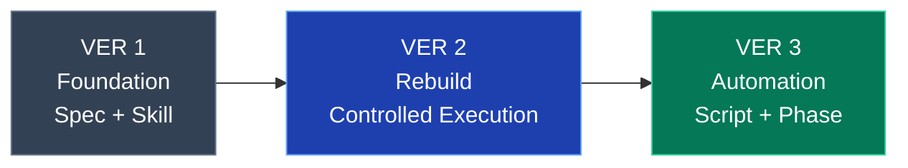
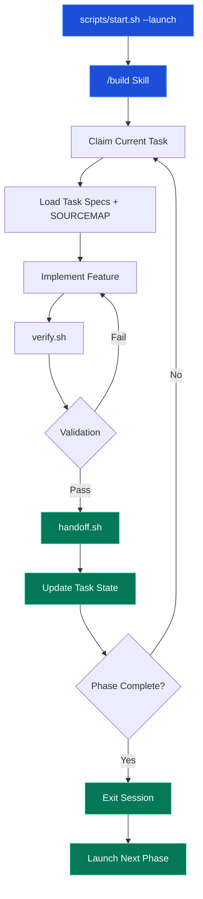
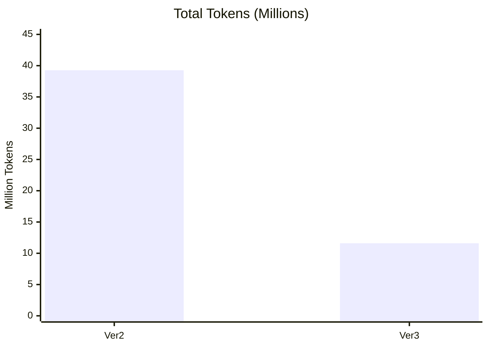
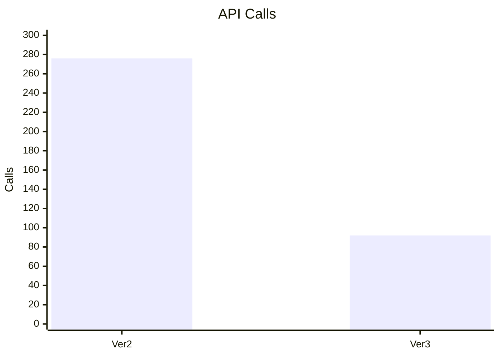

# 🚢 Shipyard Token Optimization

### Engineering a More Efficient AI Development Workflow

**Claude Code를 활용한 명세 기반 자동 개발과 토큰 최적화 실험**

단순한 프롬프트 개선을 넘어, 개발 프로세스 자체를 자동화하다.

[**Ver1 · Foundation**](https://github.com/Jihoons-Growthlab/shipyard-TokenOptimization) · [**Ver2 · Rebuild**](https://github.com/Jihoons-Growthlab/shipyard-TokenOptimization-ver2) · [**Ver3 · Automation**](https://github.com/Jihoons-Growthlab/shipyard-TokenOptimization-ver3)

---

### PERFORMANCE HIGHLIGHTS

| **−70.5%** | **−66.7%** | **−72.1%** |
|:---:|:---:|:---:|
| Total Tokens | API Calls | Cache Read Tokens |
| Ver2 → Ver3 | Ver2 → Ver3 | Ver2 → Ver3 |

---

## 01. PROJECT OVERVIEW

### AI 개발의 효율은 프롬프트가 아닌 워크플로에서 시작된다.

Claude Code로 복잡한 웹 애플리케이션을 구현하는 과정에서는 코드 생성뿐 아니라 파일 탐색, 컨텍스트 유지, 테스트, 화면 검증, 진행 상태 관리에도 토큰이 소비됩니다.

이 프로젝트에서는 **조선소 통합관리 시스템(SWP Shipyard)** 을 공통 실험 대상으로 삼아, 개발 방식의 변화를 세 가지 버전으로 구현하고 분석했습니다.

| Version | Focus | Engineering Approach |
|---|---|---|
| **Ver1** | Foundation | 명세·Skill 기반 개발 표준화 |
| **Ver2** | Rebuild | 동일 명세 기반 재구현 및 호출 분석 |
| **Ver3** | Automation | 스크립트 기반 자동화 및 컨텍스트 관리 |

**핵심 목표**

> AI가 반드시 판단해야 하는 일과 스크립트로 처리할 수 있는 일을 분리해, 기능 구현에 필요한 작업을 유지하면서 반복적인 API 호출과 컨텍스트 소비를 줄이는 것.

---

## 02. PROJECT SHOWCASE

### SWP Shipyard — Shipyard Management Platform

호선 관리, 공정 계획, 생산 실적, 도면 결재, 사용자 권한 관리와 Unity 기반 3D 뷰어를 통합한 웹 애플리케이션입니다.

### Dashboard

*조선소 통합관리 대시보드 — 주요 KPI 및 공정 진행 현황*

### Authentication

*JWT 인증, 사용자 권한 및 TOTP 기반 OTP 인증*

### Main Features

| Module | Description |
|---|---|
| 🔐 Authentication | JWT 로그인, OTP 및 메뉴별 권한 |
| 🚢 Hull Management | 호선 등록, 조회 및 상태 관리 |
| 📅 Process Planning | 공정 계획 및 Gantt Chart |
| 📊 Daily Progress | 공정별 생산 실적 및 진척 관리 |
| 📐 Drawing Management | 도면 업로드, 조회 및 승인 |
| ✅ Approval Workflow | 업무 결재 및 승인 상태 관리 |
| 👥 User Management | 사용자 및 권한 관리 |
| 🧊 Unity 3D Viewer | Web 기반 호선 3D 시각화 |

### Technology Stack

**Application**

**Automation & Verification**

---

## 03. WORKFLOW EVOLUTION

### From Prompt Engineering to Workflow Engineering

### VERSION 01 — Foundation

**명세 기반 개발과 개발 절차 표준화**

[View Repository](https://github.com/Jihoons-Growthlab/shipyard-TokenOptimization)

초기 개발 방식에서는 기능별 프롬프트, CLAUDE.md, Skill, MCP, 기능명세, 진행 기록을 활용해 개발 과정을 정리했습니다.

**적용 기술**

- `CLAUDE.md` 기반 공통 개발 지침
- `.claude/skills/`를 통한 구현 절차 정의
- `specs/` 기반 요구사항·수용 기준 관리
- `PROGRESS.md`를 통한 진행 상태 기록
- `/rebuild`를 활용한 연속 단계 실행
- Playwright MCP 기반 UI 검증

**Ver1 내부 최적화 측정**

| Metric | Before | After | Change |
|---|---:|---:|---:|
| Total Tokens | 64.90M | 21.00M | **−67.6%** |
| API Responses | 425 | 63 | **−85.2%** |
| Tool Calls | 678 | 138 | **−79.6%** |

**Key Insight**

반복적인 프롬프트보다 명세와 작업 절차를 재사용하는 구조가 누적 API 왕복을 줄이는 데 유용하다는 것을 확인했습니다.

---

### VERSION 02 — Rebuild

**명세 기반 재구현과 토큰 사용 패턴 분석**

[View Repository](https://github.com/Jihoons-Growthlab/shipyard-TokenOptimization-ver2)

Ver2에서는 공통 명세와 화면 자료를 기준으로 SWP Shipyard를 다시 구현하고, 토큰 소비 패턴을 분석했습니다.

**주요 구성**

- Claude Opus 5.5 기반 구현
- 명세와 화면 자료 분리
- 기능별 작업 세션 운영
- 테스트 및 브라우저 검증
- 세션별 API 사용량 기록

**Execution Metrics**

| Metric | Result |
|---|---:|
| Total Tokens | 39,270,601 |
| API Calls | 276 |
| Output Tokens | 380,829 |
| Cache Read | 37,975,461 |
| Tool Calls | 332 |
| Sessions | 6 |

**Key Insight**

세션별로 반복되는 조회와 파일 탐색, 브라우저 검증 과정에서 API 호출과 캐시 읽기 토큰이 크게 누적되는 양상을 확인했습니다.

---

### VERSION 03 — Automation

**스크립트 기반 개발 자동화와 컨텍스트 최적화**

[View Repository](https://github.com/Jihoons-Growthlab/shipyard-TokenOptimization-ver3)

Ver3는 AI가 직접 수행하던 반복 작업을 Shell과 Python 스크립트로 분리하고, 각 Phase를 독립된 Claude Code 세션으로 실행하는 구조로 전환했습니다.

**주요 개선 사항**

| Optimization | Implementation |
|---|---|
| Session Isolation | Phase별 신규 Claude 프로세스 |
| Context Reduction | 필요 명세와 파일만 선택 로딩 |
| Source Discovery | `SOURCEMAP.md` 자동 생성 |
| Test Automation | `verify.sh` |
| State Management | `handoff.sh` |
| Environment Setup | `start.sh`, `dev.sh` |
| UI Verification | `shots.mjs` |
| MCP Isolation | `--strict-mcp-config` |

**Architecture**

**Key Insight**

환경 점검, 진행 상태 관리, 검증 결과 처리 등 반복 가능한 작업을 스크립트로 이전해 API 호출을 줄이고, 각 세션이 처리할 컨텍스트를 분리했습니다.

---

## 04. PERFORMANCE ANALYSIS

### Ver2 vs Ver3 — Measured Results

| Metric | Ver2 | Ver3 | Improvement |
|---|---:|---:|---:|
| **Total Tokens** | 39,270,601 | 11,598,368 | **−70.5%** |
| **API Calls** | 276 | 92 | **−66.7%** |
| Cache Read | 37,975,461 | 10,595,880 | −72.1% |
| Cache Creation | 913,747 | 659,757 | −27.8% |
| Output Tokens | 380,829 | 342,547 | −10.1% |
| Short Responses | 173 | 38 | −78.0% |
| Tool Calls | 332 | 232 | −30.1% |
| Measurement Duration | 115 min | 85 min | −26.1% |

### Total Token Consumption

### API Call Comparison

### Where Did the Tokens Go?

| Token Category | Ver2 | Ver3 |
|---|---:|---:|
| Input | 564 | 184 |
| Output | 380,829 | 342,547 |
| Cache Creation | 913,747 | 659,757 |
| Cache Read | 37,975,461 | 10,595,880 |

캐시 읽기 토큰은 Ver2 전체 토큰의 약 96.7%, Ver3 전체 토큰의 약 91.4%를 차지했습니다.

**가장 큰 변화는 생성 코드의 양보다 API 왕복과 누적 컨텍스트 처리량에서 나타났습니다.**

> 측정 기준: Ver2·Ver3는 동일 명세와 참고 자료, Claude Code 버전, 모델 및 effort 설정을 사용한 실행 기록입니다. 표시된 토큰 합계는 캐시 토큰을 포함한 처리량이며 API 청구 금액은 아닙니다.

---

## 05. WORKFLOW ENGINEERING

### Core Optimization Strategies

#### 01 — Minimize Repeated Context Loading

매 세션의 전체 코드 재탐색 대신, 필요한 API 계약과 컴포넌트 인터페이스를 `SOURCEMAP.md`에서 조회합니다.

#### 02 — Automate Deterministic Tasks

환경 검사, 테스트 실행, 로그 요약, 진행 상태 기록은 스크립트가 담당하도록 구성했습니다.

#### 03 — Isolate Execution Phases

백엔드, 프론트엔드, 공통 화면, Unity 작업을 Phase로 구분하고 새로운 Claude Code 프로세스에서 실행합니다.

#### 04 — Reduce Unnecessary Tool Exposure

개발 단계에 필요한 도구만 사용하도록 MCP와 Claude Code 실행 환경을 구성했습니다.

#### 05 — Keep AI Focused on Implementation

Claude Code는 비즈니스 로직 및 코드 구현에 집중하고, 반복 검증과 상태 갱신은 정해진 절차가 처리하도록 분리했습니다.

---

## 06. REPOSITORY NAVIGATION

### Explore the Experiments

| Version | Repository | Main Focus |
|---|---|---|
| **01** | [Foundation](https://github.com/Jihoons-Growthlab/shipyard-TokenOptimization) | 명세·Skill 기반 개발 표준화 |
| **02** | [Rebuild](https://github.com/Jihoons-Growthlab/shipyard-TokenOptimization-ver2) | 재구현 및 호출 패턴 분석 |
| **03** | [Automation](https://github.com/Jihoons-Growthlab/shipyard-TokenOptimization-ver3) | 스크립트 자동화 및 토큰 최적화 |

---

### Build Smarter. Reduce Repetition. Engineer the Workflow.

**AI를 단순한 코드 생성 도구로 사용하는 것을 넘어, 개발 프로세스 전체를 설계하고 최적화하는 프로젝트.**

`Claude Code` · `Workflow Automation` · `Token Optimization` · `Spec-Driven Development`

**Jihoons Growth Lab**

